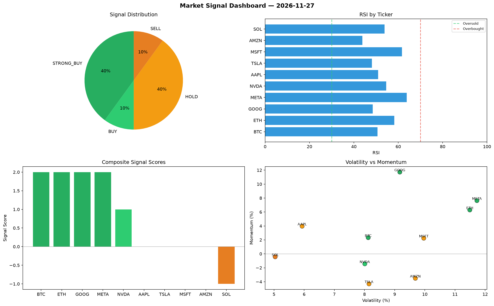

# Market Signal Report — 2026-11-27

**Run ID:** `36a7e77921` | **Buy:** 5 | **Sell:** 1 | **Hold:** 4

## Signal Dashboard

| Ticker | Price | Signal | Score | RSI | Momentum | Confidence |
|--------|-------|--------|-------|-----|----------|------------|
| BTC | $2728.72 | **STRONG_BUY** | 2 | 50.61 | 0.0232 | 0.5 |
| ETH | $4778.5 | **STRONG_BUY** | 2 | 58.21 | 0.0629 | 0.5 |
| GOOG | $4891.8 | **STRONG_BUY** | 2 | 48.51 | 0.1172 | 0.5 |
| META | $442.32 | **STRONG_BUY** | 2 | 63.87 | 0.0763 | 0.5 |
| NVDA | $3463.31 | **BUY** | 1 | 54.53 | -0.0144 | 0.25 |
| AAPL | $3417.87 | **HOLD** | 0 | 50.91 | 0.0396 | 0.0 |
| TSLA | $2760.35 | **HOLD** | 0 | 48.12 | -0.0431 | 0.0 |
| MSFT | $4188.45 | **HOLD** | 0 | 61.65 | 0.0224 | 0.0 |
| AMZN | $3079.12 | **HOLD** | 0 | 43.87 | -0.0351 | 0.0 |
| SOL | $461.89 | **SELL** | -1 | 53.8 | -0.0043 | 0.25 |

## Delta vs Yesterday

| Ticker | Today | Yesterday | Price Change | Signal Changed |
|--------|-------|-----------|-------------|----------------|
| BTC | STRONG_BUY | STRONG_SELL | 📈 65.1% | ⚠️ YES |
| ETH | STRONG_BUY | HOLD | 📈 117.83% | ⚠️ YES |
| GOOG | STRONG_BUY | STRONG_SELL | 📈 81.2% | ⚠️ YES |
| META | STRONG_BUY | STRONG_BUY | 📈 62.41% | — |
| NVDA | BUY | STRONG_BUY | 📈 469.93% | ⚠️ YES |
| AAPL | HOLD | STRONG_BUY | 📈 153.63% | ⚠️ YES |
| TSLA | HOLD | HOLD | 📉 -18.02% | — |
| MSFT | HOLD | HOLD | 📈 384.23% | — |
| AMZN | HOLD | STRONG_SELL | 📈 446.43% | ⚠️ YES |
| SOL | SELL | BUY | 📉 -86.46% | ⚠️ YES |