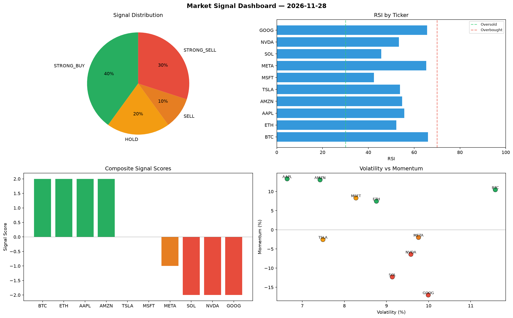

# Market Signal Report — 2026-11-28

**Run ID:** `974afcb3eb` | **Buy:** 4 | **Sell:** 4 | **Hold:** 2

## Signal Dashboard

| Ticker | Price | Signal | Score | RSI | Momentum | Confidence |
|--------|-------|--------|-------|-----|----------|------------|
| BTC | $2763.24 | **STRONG_BUY** | 2 | 66.07 | 0.1046 | 0.5 |
| ETH | $4446.2 | **STRONG_BUY** | 2 | 52.21 | 0.0747 | 0.5 |
| AAPL | $4558.4 | **STRONG_BUY** | 2 | 55.69 | 0.133 | 0.5 |
| AMZN | $1620.11 | **STRONG_BUY** | 2 | 54.74 | 0.1304 | 0.5 |
| TSLA | $2603.8 | **HOLD** | 0 | 53.78 | -0.0254 | 0.0 |
| MSFT | $4671.49 | **HOLD** | 0 | 42.44 | 0.0831 | 0.0 |
| META | $165.86 | **SELL** | -1 | 65.29 | -0.0198 | 0.25 |
| SOL | $1243.02 | **STRONG_SELL** | -2 | 45.65 | -0.1229 | 0.5 |
| NVDA | $1633.46 | **STRONG_SELL** | -2 | 53.34 | -0.0639 | 0.5 |
| GOOG | $2350.58 | **STRONG_SELL** | -2 | 65.64 | -0.1701 | 0.5 |

## Delta vs Yesterday

| Ticker | Today | Yesterday | Price Change | Signal Changed |
|--------|-------|-----------|-------------|----------------|
| BTC | STRONG_BUY | STRONG_BUY | 📈 884.31% | — |
| ETH | STRONG_BUY | STRONG_BUY | 📈 179.07% | — |
| AAPL | STRONG_BUY | HOLD | 📈 257.82% | ⚠️ YES |
| AMZN | STRONG_BUY | HOLD | 📉 -56.05% | ⚠️ YES |
| TSLA | HOLD | HOLD | 📈 506.69% | — |
| MSFT | HOLD | STRONG_BUY | 📉 -6.29% | ⚠️ YES |
| META | SELL | STRONG_BUY | 📉 -81.18% | ⚠️ YES |
| SOL | STRONG_SELL | STRONG_BUY | 📉 -59.05% | ⚠️ YES |
| NVDA | STRONG_SELL | STRONG_BUY | 📉 -58.85% | ⚠️ YES |
| GOOG | STRONG_SELL | STRONG_BUY | 📈 48.2% | ⚠️ YES |